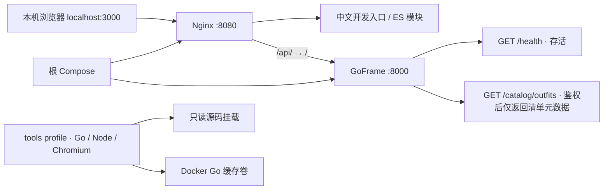

# VowMirror 当前架构

更新日期：2026-11-14，开发分支 `feat/wedding-phase-2-assets`。本文描述开发基础与 Phase 2 素材目录，未来双人生成仅列为计划。实施前完整草稿已备份，本轮证据见 [长期计划](plan/2026-11-05-wedding-project-roadmap.md)。

## 运行与边界

宿主机只映射 `127.0.0.1:3000`。8000 位于容器网络，未映射宿主机。静态镜像只复制入口与 web 模块，Nginx 只允许入口、指定模块与 API 代理，其余路径 404；不把仓库根作为静态文件目录。

[main.go](../backend/main.go) 调用 [cmd.NewServer](../backend/internal/cmd/cmd.go)：显式加载唯一配置模板、验证 Token、固定 `:8000`、注册健康路由。缺失／非法 Token 或模板返回明确错误，进程退出；不自动关闭鉴权或搜索旧配置。

`GET /api/health` 返回 `{code:0,message:"",data:{status:"ok"}}`，带请求标识和 no-store。健康无需 Token、没有模型调用。`GET /api/catalog/outfits` 需要 Token，只返回唯一清单的套装／姿势元数据；旧路由、Hello 和生成路由均 404。

## 模块与状态

| 模块 | 当前用途与边界 |
|---|---|
| [web/image-core.mjs](../web/image-core.mjs) | 读取 Blob，保留字节和真实 MIME；结果签名与扩展名解析；无设置、存储或网络依赖 |
| [web/response-core.mjs](../web/response-core.mjs) | JSON 响应解析和受控错误映射；格式错误直接失败，不显示原始上游正文 |
| [web/app.mjs](../web/app.mjs) | 同源健康检查、5 秒超时、可见失败和手动重新检查；无上传或生成 |
| [imagevalidate](../backend/internal/imagevalidate/validate.go) | Base64/Data URL、类型、图片头、256–8192 边长、2000 万像素、单图 8 MiB 等核心校验 |
| [security](../backend/internal/security/service.go) | Token 摘要恒定时间比对、进程内限流／并发组件；继承额度组件未接入业务路由，后续生成不使用额度扣减；无隐式全局默认服务 |
| [middleware](../backend/internal/middleware/auth.go) | 保留独立鉴权、CORS、请求体、限流、请求标识组件；由路由组接线，不再内部识别旧单人路径 |
| [云端协议](../backend/internal/logic/tryon/generator.go) | OpenAI 兼容、豆包、Gemini 的继承代码；构造配置显式传入，没有任何生产路由调用 |
| [compose.yaml](../compose.yaml) | 唯一运行与检查入口；工具不会随应用启动；源码只读、Go 缓存命名卷 |

当前页面不写 localStorage／IndexedDB，不上传照片，不调用供应商。后端健康请求只在内存处理；日志送 stdout。没有数据库、队列、账号或后台。未来 Token 可在浏览器保存，人物／结果只保留当次内存，不迁移旧历史。

## 继承协议的限制与接线门槛

保留适配器仍使用旧“两张 Base64 字符串”接口；不是婚礼 API。已经移除单人提示词、重复编排、额外视觉调用、浏览器模型配置、ComfyUI 与旧配置回退。模型 HTTP 客户端不跟随重定向，工厂要求远程 HTTPS。

以下旧协议问题仍须在 Phase 3 闭合后才可接线：真实输入 MIME 当前尚未贯穿云端映射；OpenAI 兼容请求不代表官方编辑接口兼容；上游原始错误正文仍需统一转换；结果 URL 需明确来源／状态／下载字节上限；输出还需完整尺寸、格式与单张校验。当前没有路由可以触发这些协议，不能宣称已验证婚礼四／五图或安全生成能力。

并发和限流是进程内状态，不支持多实例共享。后续生成统一校验输入、模型配置和并发准入，不接入费用、汇率、额度统计或预算拦截；本轮只调整文档，未改动继承安全组件。60 秒提交到查看的生成硬期限属于后续需求，当前仅健康检查 5 秒前端超时。

两张合照及九张场地图只存放在 Git 与 Docker 构建上下文均忽略的 `assets/wedding/private/`，其中 `intake.json` 是唯一私有接收清单。工具容器显式只读核验；应用镜像、接口和场馆目录不读取这些文件。四张必填模型参考为合照、婚纱、男装和男鞋特写，可选场地图后最多五张，不实现左右肖像。

## 验证与文档归属

Go 核心、健康／旧路由、Token 配置测试；Node 直接导入 ES 模块；三格式自有夹具缺失必须失败。浏览器工具实际访问 Nginx 页面和后端健康，不用模拟服务代替集成链；仅错误显示分支使用受控 502。

本地与 CI 调用同一 Docker 脚本，远端检查以 GitHub Actions 对应提交的实际结果为准。旧蓝图中的 Windows、ComfyUI 和探针记录不视为本轮 Docker 验收；真实供应商、人物效果和费用均未测试。

[Docker 开发说明](DOCKER_DEVELOPMENT.md) 是命令与环境说明；[长期计划](plan/2026-11-05-wedding-project-roadmap.md) 是决策、阶段与本轮证据；[代码来源](CODE_PROVENANCE.md) 记录继承代码和图片授权边界。
