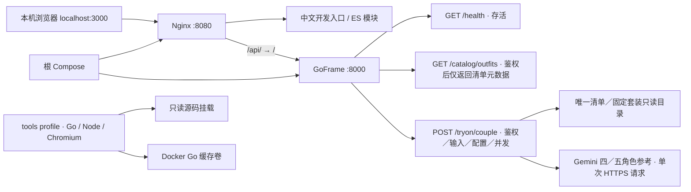

# VowMirror 当前架构

更新日期：2026-11-16，开发分支 `feat/wedding-phase-4-basic-ui`。本文描述开发基础、素材目录、Phase 3 双人生成 API 与 Phase 4 浏览器工作流；真实模型调用仍需单独授权。实施前完整草稿已备份，本轮证据见 [长期计划](plan/2026-11-05-wedding-project-roadmap.md)。

## 运行与边界

宿主机只映射 `127.0.0.1:3000`。8000 位于容器网络，未映射宿主机。静态镜像只复制入口与 web 模块，Nginx 只允许入口、指定模块与 API 代理，其余路径 404；不把仓库根作为静态文件目录。

[main.go](../backend/main.go) 调用 [cmd.NewServer](../backend/internal/cmd/cmd.go)：显式加载唯一配置模板、验证 Token、固定 `:8000`、注册健康路由。缺失／非法 Token 或模板返回明确错误，进程退出；不自动关闭鉴权或搜索旧配置。

`GET /api/health` 返回 `{code:0,message:"",data:{status:"ok"}}`，带请求标识和 no-store。健康无需 Token、没有模型调用。`GET /api/catalog/outfits` 与 `POST /api/tryon/couple` 需要 Token；旧单人、ComfyUI 和 Hello 路由均 404。请求标识始终由服务器生成，不回显任意客户端标记。

## 模块与状态

| 模块 | 当前用途与边界 |
|---|---|
| [web/image-core.mjs](../web/image-core.mjs) | 读取 Blob，保留字节和真实 MIME；结果签名与扩展名解析；无设置、存储或网络依赖 |
| [web/response-core.mjs](../web/response-core.mjs) | JSON 响应解析和受控错误映射；格式错误直接失败，不显示原始上游正文 |
| [web/app.mjs](../web/app.mjs) | 同源目录读取与双人生成；冻结单次请求快照、60 秒取消／期限、错误恢复、真实 MIME 结果下载及 Object URL 生命周期 |
| [imagevalidate](../backend/internal/imagevalidate/validate.go) | 上传、素材与结果共用字节／真实 MIME／完整解码校验；256–8192 边长、2000 万像素、单图 8 MiB |
| [security](../backend/internal/security/service.go) | Token 摘要恒定时间比对、进程内限流／并发组件；继承额度组件未接入业务路由，后续生成不使用额度扣减；无隐式全局默认服务 |
| [middleware](../backend/internal/middleware/auth.go) | 保留独立鉴权、CORS、请求体、限流、请求标识组件；由路由组接线，不再内部识别旧单人路径 |
| [云端协议](../backend/internal/logic/tryon/generator.go) | 显式模型配置与 HTTP transport；仅 Gemini 3.1 Flash Image 闭合四／五图，其余协议／型号返回能力错误；旧双图实现已移除 |
| [婚礼编排](../backend/internal/logic/tryon/couple.go) | 唯一编排；生成器工厂、素材读取器、并发准入接口构造注入；一次提交一次模型请求，无视觉附加调用、自动重试或切模型 |
| [固定素材读取](../backend/internal/catalog/reader.go) | 只按 ID 从清单解析三张图；OpenRoot 限定目录、拒绝逃逸与非普通文件；缺图／损坏明确失败 |
| [compose.yaml](../compose.yaml) | 唯一运行与检查入口；工具不会随应用启动；源码只读、Go 缓存命名卷 |

页面通过用户操作将照片和结果仅保存在当前页面内存；刷新不恢复照片／结果。Token 默认不保存，勾选后只将访问 Token 写入 localStorage；不写 IndexedDB。页面只请求同源 API，不直接调用模型供应商。后端健康请求只在内存处理；日志送 stdout。没有数据库、队列、账号或后台。

## 双人生成契约与安全出口

请求字段仅为 `couple_image`、`outfit_id`、`dress_side` 和 `scene`。婚纱位置为按画面观察的 `left`／`right`；场地为 `{ "mode": "original" }` 或 `{ "mode": "upload", "image": "Base64/Data URL" }`，原背景不得带 image 字段。拒绝未知、重复、大小写变体、空值及尾随 JSON；不接受肖像、素材路径、出口、Key 或模型名。

有序参考为合照、婚纱、男装、男鞋特写及可选场地图，含角色、原字节和真实 MIME。提示词固定对应画面左右、身份、不混穿、完整鞋履及全身；场地只用于背景。Gemini 请求逐图附角色标签，要求一个候选、单张横版 `3:2`／`1K`；响应为一张 Base64 图片、`mime_type`、实际宽高、配置模型与服务器 `request_id`，统一封装在 `{code,message,data}` 中。

模型出口仅来自服务器运行时环境，必须 HTTPS，Key 只在请求头，拒绝重定向。首测协议只接受内联结果；URL 结果明确失败，无额外下载或任意来源访问。响应状态、JSON 字节数、单张数量、真实 MIME、完整格式及横版尺寸均校验；上游正文、错误字符串和配置不返回客户端、不记日志。请求体 24 MiB，单图 8 MiB，四／五图原始总量 14 MiB，实际序列化模型请求不超过 20,000,000 字节；这是依据 [Gemini 官方内联限制](https://ai.google.dev/gemini-api/docs/image-understanding#inline-image) 选择的保守边界，不代表真实模型质量验收。

生成 API 的 24 MiB 请求体上限由 Nginx 传输边界与后端流式读取共同执行，关闭 GoFrame 默认的 8 MiB 隐式限制。Nginx 提前拦截超限请求时返回标准 JSON 413、服务器请求 ID、安全头和 `no-store`，不再返回默认 HTML；未鉴权超限请求同样返回 413。保留代理拦截是为了避免流式上传中后端提前断开被转换为 502；真实入口回归约束两层 413 契约一致，图片和模型校验只在后端执行。

并发为进程内状态，全局 2、每 Token 主体 1。55 秒上下文覆盖请求解析与生成，客户端断开会取消上游；服务端同时设置 55 秒读取／60 秒写入期限。准入后所有退出释放资源，不接入费用、额度统计或预算拦截。前端健康检查为 5 秒，生成请求在浏览器 60 秒硬期限后取消；真实模型时延属于后续实测。

两张合照及九张场地图只存放在 Git 与 Docker 构建上下文均忽略的 `assets/wedding/private/`，其中 `intake.json` 是唯一私有接收清单。工具容器显式只读核验；应用镜像、接口和场馆目录不读取这些文件。应用只读挂载 30 个固定套装目录，不挂载 private 或 poses。用户上传和结果只在请求内存；Nginx 关闭请求／响应代理缓冲及响应临时文件，不在服务器落盘。不实现左右肖像。

## 验证与文档归属

Go 核心、健康／旧路由、Token 配置测试；Node 直接导入 ES 模块；三格式自有夹具缺失必须失败。浏览器工具实际访问 Nginx 页面和后端健康，不用模拟服务代替集成链；仅错误显示分支使用受控 502。

本地与 CI 调用同一 Docker 脚本，远端检查以 GitHub Actions 对应提交的实际结果为准。旧蓝图中的 Windows、ComfyUI 和探针记录不视为本轮 Docker 验收；真实供应商、人物效果和费用均未测试。

[Docker 开发说明](DOCKER_DEVELOPMENT.md) 是命令与环境说明；[长期计划](plan/2026-11-05-wedding-project-roadmap.md) 是决策、阶段与本轮证据；[代码来源](CODE_PROVENANCE.md) 记录继承代码和图片授权边界。
