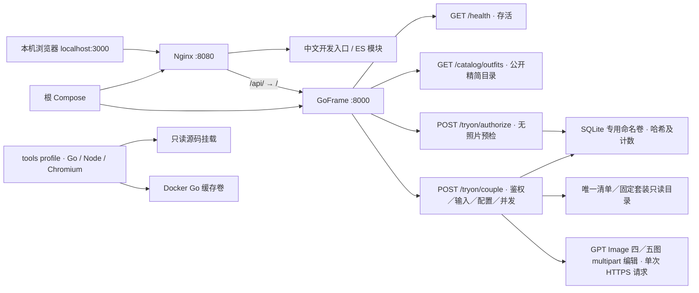

# VowMirror 架构快照（2026-11-20）

本文正文保留该日期的架构快照。当前整合版已增加受控姿势只读挂载和四至六图生成，
以 [Docker 开发说明](DOCKER_DEVELOPMENT.md) 与 [工作区整合记录](WORKSPACE_INTEGRATION.md) 为准。

更新日期：2026-11-20，Phase 8 开发分支 `feat/wedding-phase-8-ui`。本文描述开发基础、素材目录、双人生成 API、浏览器工作流、场地参考与 Phase 7 GPT Image 接入；真实模型调用
仍需单独授权。本轮证据见 [Phase 8 验收记录](plan/2026-11-19-phase8-ui.md)。

## 运行与边界

宿主机只映射 `127.0.0.1:3000`。8000 位于容器网络，未映射宿主机。静态镜像只复制入口与 web 模块，Nginx 只允许入口、指定模块与 API 代理，其余路径 404；不把仓库根作为静态文件目录。

[main.go](../backend/main.go) 调用 [cmd.NewServer](../backend/internal/cmd/cmd.go)：显式加载唯一配置模板、验证 Token、固定 `:8000`、注册健康路由
。缺失／非法 Token 或模板返回明确错误，进程退出；不自动关闭鉴权或搜索旧配置。

`GET /api/health` 返回 `{code:0,message:"",data:{status:"ok"}}`，带请求标识和 no-store。健康无需 Token、没有模型调用。公开
`GET /api/catalog/outfits` 仅返回版本、套装 ID／名称和场馆 ID／名称，不包含素材路径、姿势清单或服装角色映射；生成 `POST /api/tryon/couple` 仍要求有效 Token。旧单人、
ComfyUI 和 Hello 路由均 404。请求标识始终由服务器生成，不回显任意客户端标记。

## 模块与状态

| 模块 | 当前用途与边界 |
| --- | --- |
| [web/image-core.mjs](../web/image-core.mjs) | 合照／场地共用 Blob 校验，保留字节和真实 MIME；浏览器完整解码、尺寸及像素校验并释放位图；结果签名与扩展名解析；无设置、存储或网络依赖 |
| [web/response-core.mjs](../web/response-core.mjs) | JSON 响应解析和受控错误映射；格式错误直接失败，不显示原始上游正文 |
| [web/sse-core.mjs](../web/sse-core.mjs) | 有界 UTF-8 SSE 消费；按实际字节限制单事件 12 MiB、整流 13 MiB，拒绝未知事件、断流及重复终态；取消读取释放 reader，无自动重连或 JSON 成功回退 |
| [web/app.mjs](../web/app.mjs) | 同源目录读取与双人生成；冻结单次请求快照、90 秒取消／期限、错误恢复、真实 MIME 结果下载及 Object URL 生命周期 |
| [imagevalidate](../backend/internal/imagevalidate/validate.go) | 上传、素材与结果共用字节／真实 MIME／完整解码校验；256–8192 边长、2000 万像素、单图 8 MiB |
| [security](../backend/internal/security/service.go) | 完整 SHA-256 摘要恒定时间比对、已接线的按码限流／并发、唯一 SQLite 成功与 UTC 每日尝试账本；存储故障明确失败；无隐式全局服务 |
| [middleware](../backend/internal/middleware/auth.go) | 保留独立鉴权、CORS、请求体、限流、请求标识组件；由路由组接线，不再内部识别旧单人路径 |
| [云端协议](../backend/internal/logic/tryon/generator.go) | 显式模型配置与 HTTP transport；仅 `chuanapi`／`gpt-image-2.5-flare` 四／五图编辑；GPT Image 传输为唯一实现，旧 Gemini 实现已移除 |
| [婚礼编排](../backend/internal/logic/tryon/couple.go) | 唯一编排；生成器工厂、素材读取器、并发准入和用量接口构造注入；一次提交一次模型请求，无视觉附加调用、自动重试或切模型 |
| [固定素材读取](../backend/internal/catalog/reader.go) | 只按 ID 从唯一清单解析套装三张图或固定场馆一张图；共用读取／完整解码，OpenRoot 限定目录、拒绝逃逸与非普通文件；缺图／损坏明确失败 |
| [compose.yaml](../compose.yaml) | 唯一运行与检查入口；工具不会随应用启动；源码只读、Go 缓存命名卷 |

页面通过用户操作将照片和结果仅保存在当前页面内存；刷新不恢复照片／结果。表单有效后才打开生成码弹窗；每次请求都重新输入，使用或关闭后清空。移除链接传码与本地记码，启动时清除旧版本保存的生成码；不写 IndexedDB。页面只请求同源
API，不直接调用模型供应商。后端健康请求只在内存处理；日志送 stdout。只有后端专用卷中的 SQLite 用量数据库，不存照片、结果或原始码；没有队列、账号或后台。

## 双人生成契约与安全出口

生成仍为同源 `POST /api/tryon/couple`、JSON 请求和 Bearer 鉴权。严格 JSON、请求大小及鉴权错误保留原 HTTP/JSON 响应；开流后 HTTP 200 仅表示 SSE 已建立，事件固定为真实阶
段 `status`、每 10 秒一次的 `heartbeat` 和唯一 `result`／`error` 终态。成功终态承载原 `{code,message,data}`，错误终态的 `data.http_status` 保留业务错误
状态。单一写协程检查 Write／Flush 错误，取消后等待生成协程退出和并发名额释放；诊断仅含经过校验的请求标识、阶段与耗时、状态、错误类别和字节数。

请求字段仅为 `couple_image`、`outfit_id` 和 `scene`。婚纱穿着者由模型依据合照判断；场地互斥为 `{ "mode": "original" }`、
`{ "mode": "upload", "image": "Base64/Data URL" }` 或 `{ "mode": "venue", "venue_id": "V001" }`。image 只允许上传模式，venue_id
只允许固定场馆模式，原背景两者均不得出现（包括空字段）。拒绝未知、重复、大小写变体、空值及尾随 JSON；不接受肖像、素材路径、出口、Key 或模型名。

唯一素材清单必含 `venues` 数组；真实固定场馆路径限定 `venues/Vxxx/`，编号 V001–V999。当前数组与本地目录为空，不创建虚构条目，页面隐藏固定场馆模式；后续有授权照片才在同一清单添加。未知编号返回
`UNKNOWN_VENUE`，缺失／损坏返回 `VENUE_UNAVAILABLE`，不切回原背景。页面原背景／上传场地切换会清除场地图及旧结果，异步解码按选择版本丢弃过期完成；生成时锁定场地编辑。

有序参考为合照、婚纱、男装、男鞋特写及可选场地图，含角色、原字节和真实 MIME。提示词固定对应身份、不混穿、完整鞋履及全身，婚纱穿着者由模型依据合照判断；场地只用于背景。GPT Image 使用官方
`POST /v1/images/edits`、有序 `image[]` 文件与真实 MIME，`n=1`、`size=1536x1024`、`quality=medium`、`output_format=png`。响应保留一张
Base64 图片、`mime_type`、实际宽高、请求型号 `model` 与应用 `request_id`，可选增加 `provider_model`／`provider_request_id`，统一封装在
`{code,message,data}` 中。供应商仅声明别名时不当作快照；缺失版本明确标注，声明其他模型则拒绝。

模型出口仅来自服务器运行时环境，必须 HTTPS，Key 只在请求头，拒绝重定向。只接受内联结果；URL 结果明确失败，无额外下载或任意来源访问。响应状态、JSON 字节数、单张数量、真实 MIME、完整格式及固定尺寸均校验；上游正文、
错误字符串和配置不返回客户端、不记日志。请求体 24 MiB，单图 8 MiB，四／五图原始总量 14 MiB，实际序列化模型请求不超过 20,000,000 字节；这是本地内存边界，不是 GPT Image 官方输入上限。结果必须是
`1536×1024` PNG。协议依据 [OpenAI 官方图片编辑 API](https://developers.openai.com/api/reference/resources/images/methods/edit)，第三
方出口的完整兼容性仍须单独授权实测。

生成 API 的 24 MiB 请求体上限由 Nginx 传输边界与后端流式读取共同执行，关闭 GoFrame 默认的 8 MiB 隐式限制。Nginx 提前拦截超限请求时返回标准 JSON 413、服务器请求 ID、安全头和
`no-store`，不再返回默认 HTML；未鉴权超限请求同样返回 413。保留代理拦截是为了避免流式上传中后端提前断开被转换为 502；真实入口回归约束两层 413 契约一致，图片和模型校验只在后端执行。

并发为进程内状态，全局 2、每 Token 主体 1。请求上下文和模型 HTTP 请求最多 85 秒，覆盖输入读取、图片校验、素材准备和上游调用；服务端写入与 Nginx 代理读取期限为 95 秒。浏览器从提交准备计时，图片成功解码并进
入可见渲染帧后才完成，90 秒硬期限覆盖全部过程；阶段状态以真实观测更新，心跳不表达进度也不延长期限。取消／超时释放结果 URL 和并发资源，迟到结果不能恢复。真实供应商时延属于后续实测。

`POST /api/tryon/authorize` 与生成共享 Bearer 校验、按码频控和账本 `Check`，仅返回 `remaining`。生成不信任预检结果：在每码串行准入内重新检查五次成功上限；GPT Image 组装完
 multipart 后、发送请求前执行注入的 `BeforeSend` 回调原子增加每日尝试。默认每日 10 次，通过运行时 `TRYON_DAILY_ATTEMPT_LIMIT` 配置，按 UTC 换日。完整结果验证和取消检查通过后
原子记成功账，写账成功才返回成功事件；此后断线不回滚。无效输入、素材或组装失败不记每日尝试；已提交上游的失败、无效结果、取消和超时记尝试、不扣成功次数。账本故障明确返回 `USAGE_UNAVAILABLE`。

SQLite 路径为 `/var/lib/vowmirror/usage.sqlite`，挂在后端专用 `usage` 卷；仅存完整 SHA-256、成功次数、UTC 日期和当日尝试次数。镜像预建目录并赋予运行用户写权限。普通部署和回滚
保留该卷；隔离验收使用独立 Compose 项目卷并仅清理本轮资源。公开展示素材另由 [公开素材清单](PUBLIC_ASSETS.md) 管理，Nginx 精确放行两个 JPEG，不开放私有素材。

两张合照及九张场地图只存放在 Git 与 Docker 构建上下文均忽略的 `assets/wedding/private/`，其中 `intake.json` 是唯一私有接收清单。工具容器显式只读核验；应用镜像、接口和场馆目录不读取这
些文件。应用只读挂载 30 个固定套装目录及空的固定场馆目录，不挂载 private 或 poses。用户上传和结果只在请求内存；Nginx 关闭请求／响应代理缓冲及响应临时文件，不在服务器落盘。不实现左右肖像。

## 验证与文档归属

Go 核心、健康／旧路由、Token 配置测试；Node 直接导入 ES 模块；三格式自有夹具缺失必须失败。浏览器工具实际访问 Nginx 页面和后端健康；生成交互由受控响应拦截，未受控生成被阻断并使测试失败；新增结果解码失败、取消／超
时后的迟到解码、Object URL 释放与完整 90 秒实际等待。

本地与 CI 调用同一 Docker 脚本，远端检查以 GitHub Actions 对应提交的实际结果为准。旧蓝图中的 Windows、ComfyUI 和探针记录不视为本轮 Docker 验收。Phase 7 唯一报告校验为 5 组可
判定／4 组合格、`phase8Ready=true`，真实取消专项通过。G1 第二次及 G3、G4、G5 六项评分全部通过；G2 三次正式尝试未合格，独立诊断最快图六项评分通过，仅补充可判定证据，不计入正式尝试或合格组数。完整耗时、失
败与供应商元数据缺失记录见 Phase 7 执行说明。

[Docker 开发说明](DOCKER_DEVELOPMENT.md) 是命令与环境说明；[长期计划](plan/2026-11-05-wedding-project-roadmap.md) 是决策、阶段与本轮证据；
[代码来源](CODE_PROVENANCE.md) 记录继承代码和图片授权边界。

评测元数据及阶段就绪判定仅由 [phase7-evaluation.mjs](../scripts/phase7-evaluation.mjs) 实现；固定矩阵、逐次指令、人工六项评分、供应商版本缺失、取消专项和受控证据约束见
[Phase 7 执行说明](plan/2026-11-18-phase7-gpt-image.md)。Phase 7 实测和 Phase 8 正式界面验收已完成；独立服务器公开上线仍是后续单独交付。
